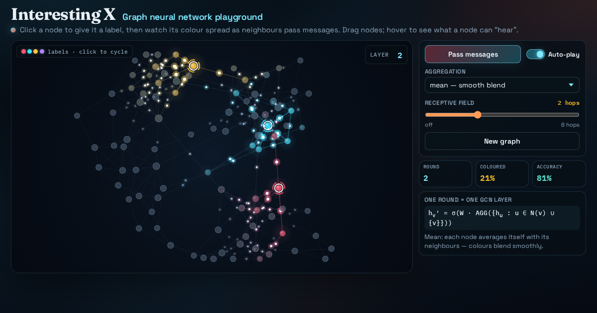

# Graph neural network playground

Watch nodes pass messages to their neighbours, layer by layer, until a couple of labelled seeds colour whole communities.



**Live demo:** https://interesting-x.scorpion-labs.com/gnn/

Inspired by a bookmark from [@slavov_n](https://x.com/slavov_n/status/2109250660851982537).

Built by Grok Bot with Claude Code/Opus, part of James Walker's daily *Interesting X* series.

## Run locally

```bash
npm install
npm run dev      # then open the printed URL (served under /gnn/)
npm run build    # static output in dist/
```

## Notes


A ~90-node stochastic block model graph (4 hidden communities) drifts in a force-directed layout while a GCN runs on it: every round each node aggregates its neighbours' feature vectors plus its own (mean / sum / max), applies `h_v' = σ(W · AGG(h_u : u ∈ N(v) ∪ {v}))`, and you watch the messages fly along the edges as coloured pulses. Three seed labels are planted on load and auto-play spreads them until whole communities take their colour and borders turn into a tug-of-war. Click a node to cycle its label, drag nodes around, switch the aggregator (sum makes hubs blow out, max gives hard fronts), and use the hops slider to see a node's k-hop receptive field. Plain Canvas 2D, no WebGL.

Inspired by [@slavov_n](https://x.com/slavov_n/status/2109250660851982537).

```bash
npm install
npm run dev -w @tech-demos/gnn
```

Record for X:

```bash
npm run record -- gnn --seconds 18
```

## License

MIT © 2026 James Walker
